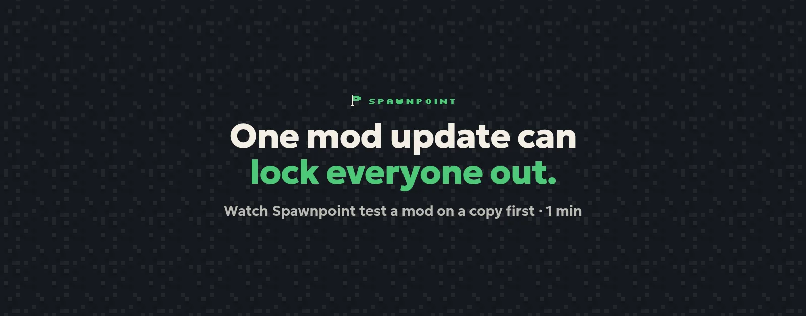
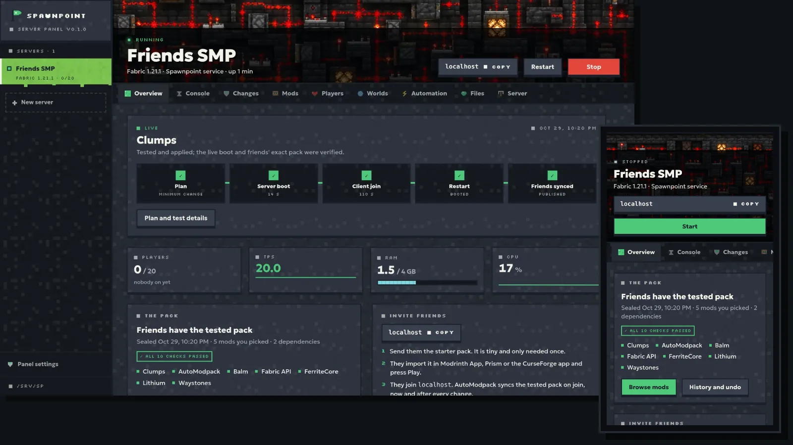
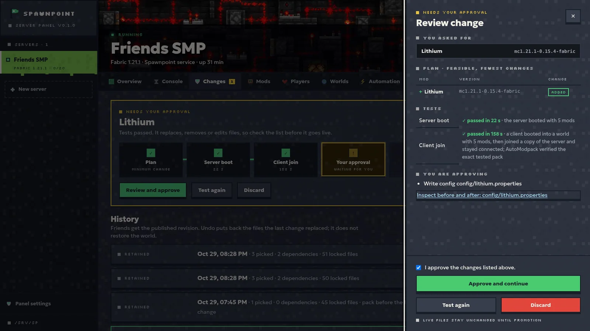

<h1 align="center">Spawnpoint</h1>

<p align="center">
  <b>A self-hosted Minecraft server panel that tests mod changes on a copy of your server before your friends get them.</b>
</p>

<p align="center">
  For people who run a modded server for friends on a spare machine, a home server or a cheap VPS.
</p>

<p align="center">
  
  <a href="https://github.com/vayungodara/spawnpoint/actions/workflows/ci.yml"></a>
  
  
  <a href="LICENSE"></a>
</p>

<p align="center">
  <a href="https://spawnpoint.vayun.net/media/tour.mp4"></a>
</p>

<p align="center">
  <a href="https://spawnpoint.vayun.net/media/tour.mp4"><b>Watch the one-minute tour</b></a>
  ·
  <a href="https://spawnpoint.vayun.net">Website</a>
  ·
  <a href="#quick-start">Quick start</a>
  ·
  <a href="#documentation">Docs</a>
  <br>
  <sub>Recorded on a real server: add a mod, test it on a copy, go live. Waits are sped up.</sub>
</p>

## Quick start

On Linux or macOS, run this as the normal user that will own your servers
(not root):

```bash
curl -fsSL https://raw.githubusercontent.com/vayungodara/spawnpoint/main/install.sh | bash
```

When it finishes, it prints a setup link with a one-time code:

```text
http://localhost:25570/setup#code=…
```

Open it on that machine, or go to `http://<server-address>:25570` from
another device and enter the code. Pick a PIN and create your first server.
Java downloads itself the first time a server needs it.

You need Node.js 22+, Python 3 and git, plus `zip` and `unzip` on Linux.
Windows, manual installs and updating are in [docs/install.md](docs/install.md).

> [!WARNING]
> Spawnpoint is alpha. Expect rough edges, and keep backups of worlds you
> care about.

## Why Spawnpoint

I run a modded server for friends. Most mod updates are fine. Every so
often one stops the server from booting, or lets it boot but keeps everyone
from joining, and I'd find out when someone messaged me.

Spawnpoint tries each change on a copy first. It checks the whole pack's
dependencies, boots a copy of the server, and on AutoModpack servers starts
a real Minecraft client that joins it. Your live server and your friends'
pack only change after the test passes, or after you approve what couldn't
be tested.

On my Linux server it reached health OK in 0.56 s, using about 60 MB
(panel only, game servers stopped).

### Is this for me?

It's for a server that should be up when your friends want to play, on a
machine that can stay on: a spare PC, a home server or a cheap VPS.
Servers can stop on their own after a while with nobody online. If you only
play while you're online yourself, hosting from your own PC or using
[e4mc](https://modrinth.com/mod/e4mc) is simpler.

### What it does

- Installs mods and plugins from Modrinth and CurseForge, resolving
  dependencies for the whole pack and keeping your existing versions where
  possible.
- Tests each mod change with a server boot and, on AutoModpack servers, a
  real client that joins with the files your friends would get (Fabric,
  Forge and NeoForge; see [supported servers](#supported-servers)).
- Keeps friends in sync with
  [AutoModpack](https://modrinth.com/mod/automodpack): they install one
  starter pack once and get every later change when they join.
- Shows what passed, failed, was skipped or is uncertain for each change.
  *Undo last change* puts back the files a change replaced, for the last
  five changes.
- Keeps servers running when the panel stops. A separate OS service owns
  Java and the console on Linux, macOS and Windows.
- Works alongside Crafty Controller, or imports stopped Crafty servers one
  at a time.

Also included: new servers from modpacks, a config editor, world slots,
nightly world backups (only when the world changed; newest three kept), a
file manager and console, TPS and memory monitoring, scheduled restarts, an
in-game status bar, idle shutdown, chunk pre-generation, a storage cleaner,
and an optional chat genie.

Each server opens in its own workspace with **Overview**, **Console**,
**Changes**, **Mods** (or **Plugins**), **Players**, **Worlds**,
**Automation**, **Files** and **Server** tabs. Panel-wide options, such as
the PIN and the server runtime, live in **Panel settings**.



## How a change goes live

Each server's **Overview** follows the open change through these steps:

1. **Plan.** A whole-pack dependency check against your Minecraft, loader
   and Java versions. Downloads must match their declared hashes.
2. **Server boot.** A sandbox boots your server's loader with the new mods.
3. **Client join.** On AutoModpack servers, a real Minecraft client boots
   with your friends' files, joins a throwaway copy and runs AutoModpack's
   handshake.
4. **Your approval.** Replacements, removals, config edits and anything
   that couldn't be fully tested wait for you in a review sheet.
5. **Restart.** Mods only change while the server is stopped. With nobody
   online it restarts on its own; with players online, you choose when.
   The world is backed up first.
6. **Friends synced.** AutoModpack serves the new pack only after the live
   boot passes and the published files match.

If the live boot or publication fails, the pack rolls back and the server
starts without the change. Pack rollback doesn't touch the world.



More detail, including memory needs and what happens when a test can't run:
[docs/testing.md](docs/testing.md).

## Supported servers

| Loader | Create in Spawnpoint | Tested mod changes |
| --- | --- | --- |
| Fabric | Every release from 1.14 | Yes (client test on 1.20+) |
| Forge | Every release from 1.5.2 | 1.20.1 with 47.4.28 only |
| NeoForge | Every release from 1.20.1 | 1.21.1 with 21.1.219 |
| Quilt | Every release from 1.14.4 | No |
| Paper, Purpur | Every release Paper or Purpur builds | No (plugins) |
| Vanilla | Every release from 1.2.5 | No |

New servers default to the newest release. Versions Spawnpoint hasn't
create-and-boot tested are labelled untested in the version picker.

Launch recipes and AutoModpack requirements: [docs/recipes.md](docs/recipes.md).

## Requirements

- Linux, macOS or Windows
- Node.js 22 or newer and Python 3
- On Linux, `zip` and `unzip` for world backups, and optionally `xvfb` so
  the client test can render on a headless machine
- Enough free memory for tests: about 1 GB for the server test and 2 to
  8 GB for the join test, depending on the mods. Tests wait instead of
  starving the live server.
- Optional: Crafty Controller on the same machine

## Letting friends in

Friends on your network join at the address the panel shows. Friends
outside your home need the game port forwarded on your router, or a free
tunnel such as [playit.gg](https://playit.gg) if you can't forward ports
(for example behind CGNAT). Spawnpoint doesn't set either up for you.

## Remote access

Keep port 25570 off the public internet. To use the panel from your phone
or away from home, join the machine to [Tailscale](https://tailscale.com)
and run `sudo tailscale serve --bg 25570` for a private HTTPS address. Full
steps: [docs/remote-access.md](docs/remote-access.md).

## Security

- Keep the panel on your LAN or a VPN. Don't expose port 25570 to the
  internet.
- Every API call except health, PIN unlock and first-run setup needs a PIN
  session or the admin token. There is no trusted local address.
- Forward only the game port. The panel turns on RCON at the game port plus
  10000 with a random password, and Minecraft binds it to every interface.
- Coding agents and other machines use the `spawnpoint` CLI with a scoped,
  revocable token from **Panel settings → API tokens**.

Details, including the admin token and the chat genie's limits:
[docs/security.md](docs/security.md).

## Documentation

| Page | What's in it |
| --- | --- |
| [Install and update](docs/install.md) | The installer, first-run setup, manual and Windows installs |
| [How mod changes are tested](docs/testing.md) | Tests, approvals, going live, rollback, memory and display |
| [Supported servers](docs/recipes.md) | Loader versions, launch recipes, the launch guard, AutoModpack |
| [The supervisor](docs/supervisor.md) | The OS service on Linux, macOS and Windows |
| [Crafty Controller](docs/crafty-import.md) | Keeping Crafty or importing servers from it |
| [Remote access](docs/remote-access.md) | Phones and remote use over Tailscale |
| [The spawnpoint CLI](docs/cli.md) | Control servers from a terminal or a coding agent, API tokens, MCP |
| [Security](docs/security.md) | Auth, RCON, the admin token, the chat genie |
| [Architecture](ARCHITECTURE.md) | How the parts fit together |

## Development

```bash
npm ci
npm run dev:server   # API on :25570
npm run dev:web      # Vite dev server, proxies /api
```

- `server/`: Fastify and TypeScript API; serves the built web app on :25570
- `web/`: Vite, React and Tailwind frontend
- `site/`: the landing page, deployed as a Cloudflare Worker
- `data/` (under the layout's `Spawnpoint/`): runtime state and secrets,
  never committed

The checks CI runs are listed in [AGENTS.md](AGENTS.md#checks).

## License

[MIT](LICENSE)
