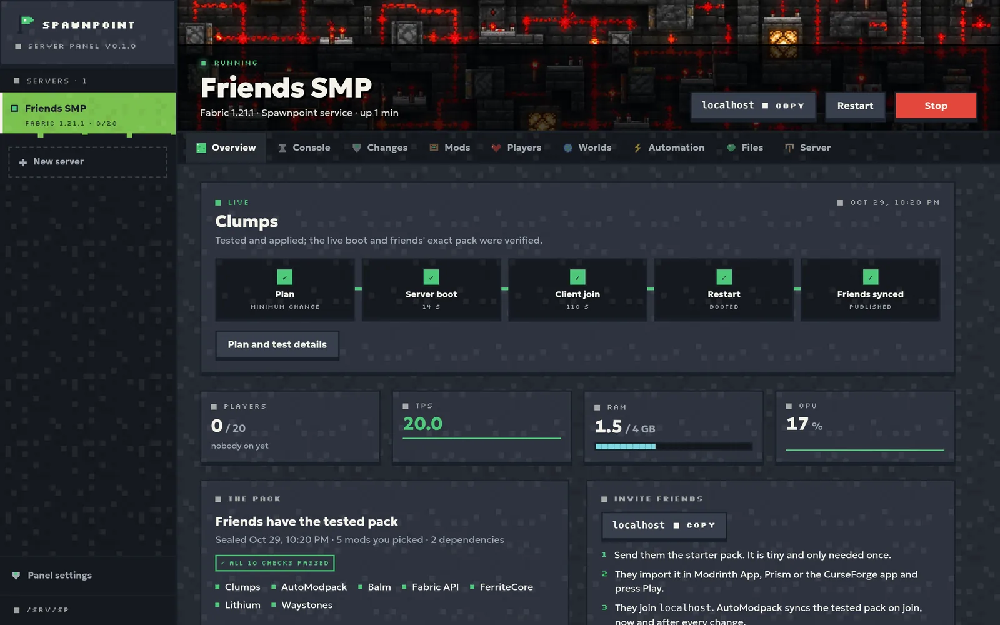

# Spawnpoint

**Add mods to your Minecraft server, test them on a copy first, and give your friends exactly the version that passed.**



Website: [spawnpoint.vayun.net](https://spawnpoint.vayun.net)

Spawnpoint is a web panel you run on the machine that hosts your Minecraft
servers. It works alongside [Crafty Controller](https://craftycontrol.com/),
which starts and supervises the server processes. Spawnpoint adds mod and
plugin installs from Modrinth and CurseForge, new servers from modpacks, a
config editor, world slots, backups and a file manager. Tested mod revisions
currently support Fabric, with three promises:

- **Friends get exactly the tested version.** A change stays out of the
  server and out of the friend pack until it passes, or until you approve
  one that could not be fully tested. Only then does
  [AutoModpack](https://modrinth.com/mod/automodpack) sync those exact files
  to players.
- **You see what was tested, skipped or uncertain.** Each revision shows
  passed, failed, skipped or inconclusive results, the renderer used, and
  the loader's own error lines.
- **You can roll back.** The files a change replaced are kept, and
  *Undo last change* puts them back (the last five changes per server).

**Status: alpha.** Expect rough edges, and keep backups.

## How mod changes are tested

Installs, updates and jars uploaded into `mods/` collect into a candidate
for that server. A few seconds after the last change, the candidate is
tested:

1. **Whole-pack dependency check** (Fabric). The solver reads native jar
   metadata, including aliases, nested libraries and client-only constraints.
   It checks compatible version histories against your Minecraft, loader and
   Java versions, keeping existing versions where possible. Requested mods
   stay in the pack, and an exact version request stays pinned. Downloads
   must match their declared hashes and size before they join the candidate.
2. **Server boot test.** A sandbox boots the server's own Fabric loader with
   the candidate's mods. Metadata compatibility is not a substitute for
   this test: runtime and mixin failures still stop the change.
3. **Client test** (servers with AutoModpack). A real Minecraft client boots
   with the files your friends would receive, then joins a throwaway server
   with the same mods and a fresh world. This uses
   [HeadlessMC](https://github.com/headlesshq/headlessmc) on Minecraft 1.20
   and newer. The Fabric join also runs
   AutoModpack's own handshake and checks that the client ends up with
   exactly the tested files.

A candidate that fails is deleted and nothing live changes, but only after
the same test passes on the current pack without it and the failure
repeats; otherwise Spawnpoint does not blame the change. A change that
could not be fully tested (the pack already fails, the test is unreliable,
no JDK yet, not enough free memory, an unsupported loader) waits for you:
approve the test gaps, test again, or discard. Unsupported launch recipes
and failed hash checks cannot be waived. Forge and NeoForge are not yet
supported by locked revisions.

Before the first revision, you must approve a required Crafty launch guard
and managed AutoModpack publication. The guard checks the locked files and
Java before every start, including starts from Crafty itself. It also keeps
a start from racing a pack swap. This requires Python 3 on the Crafty host.
The current Fabric recipe supports an explicit Tools Java path, heap flags,
and `-jar fabric.jar nogui`; custom launch recipes are refused.

Each revision locks Minecraft, the loader and its version, Java, and every
pack-owned file's path, side, SHA-512, size and source IDs. Requested mods
are recorded separately from dependencies. Tests use copies of those exact
inputs. Configs generated during testing become proposals and are retested.
Replacements, removals and config edits always need your explicit approval.
Spawnpoint never treats dropping a requested mod as success and never
changes Minecraft or the loader automatically on an existing world.

The revision report separates a feasible pack from a proved minimum-change
plan. Mod-id discovery on Modrinth is incomplete. When a complete feasible
plan exists but fewer replacements might be possible, the report says so.
A catalog or download limit without a complete plan installs nothing.
CurseForge requests retain their exact project and file IDs. If an author
disables API downloads, Spawnpoint asks for a manual download rather than
substituting a Modrinth release.

A passed, approved candidate waits for a verified restart. Server mods only
change while the server is stopped:

- Nobody online: Spawnpoint restarts the server on its own. It only does
  this when RCON confirms the server is empty.
- Players online: they get a chat warning, and you pick *Restart now*
  (30 second countdown) or *When everyone has left*.
- Server stopped: the change goes in when you start the server from the
  panel (Start, Restart or a scheduled start).

Spawnpoint backs up the world while the server is stopped, journals the pack
swap, starts the server, and waits for that boot to become ready. AutoModpack
hosting stays off until its fresh manifest and the published bytes match the
promoted revision. Friends receive only that revision's client files.

If the server fails to start or publication fails, the pack is rolled back
and the server starts without the change. The failed revision retains its
test results and reason. Pack rollback restores locked configs and pack
files, **not the world**. World restore is a separate operation that needs
your approval. *Undo last change* follows the same restart rules.
If the panel itself restarts
in the middle, it picks up where it stopped. If a change cannot be rolled
back cleanly, the server stays stopped and locked until you check it and
clear the lock on the dashboard.

Removing or disabling a Fabric mod is staged, tested and approved like an
install. It is also refused while another installed mod depends on it.

Tests wait until the machine has enough free memory for them, so they do
not starve the live server: about 1 GB for the server test, 1 to 4.5 GB for
the client test and 2 to 8 GB for the join, depending on the number of
mods. After 10 minutes a test gives up and the change waits for you. On a
4 GB machine with the server running, expect the join test to wait.

The client test needs a display. On a headless Linux machine, install `xvfb`
(`sudo apt install xvfb`) so the client renders on a virtual screen. Without
it the client runs with stubbed graphics: mod loading is tested, rendering is
not, and the verdict says so. On macOS, Windows or a Linux desktop the test
client opens as a small window for a few minutes. Either way the test runs on
this machine's graphics, so it cannot vouch for every friend's GPU, driver or
shader pack.

## Other features

- **AutoModpack client sync.** New modded servers get
  [AutoModpack](https://modrinth.com/mod/automodpack), so friends install one
  starter pack once and receive every later change on join.
- **Chat genie** (optional, off until you add a credential). Players on your
  list type `server <wish>` in chat; Claude Code turns the wish into server
  commands and checks the result before reporting success. It needs a Claude
  token or an Anthropic API key.
- Nightly world backups (on by default; only when the world changed, newest
  three kept), TPS and memory monitoring, scheduled restarts, an in-game
  status bar, idle shutdown (off by default), chunk pre-generation, and a
  storage cleaner.

## Requirements

- Node.js 22 or newer
- [Crafty Controller](https://craftycontrol.com/) on the same machine
- Linux, macOS or Windows. Java downloads automatically (Temurin) the first
  time a server needs it.
- On Linux, `zip` and `unzip` for world backups (`sudo apt install zip unzip`).

## Install

Install Crafty Controller first. Then:

```bash
curl -fsSL https://raw.githubusercontent.com/vayungodara/spawnpoint/main/install.sh | bash
```

The installer checks for Node 22, creates the layout under `~/minecraft`,
builds the panel, starts it on port **25570**, and prints a setup link with a
one-time setup code. The setup page asks for:

1. A **Crafty API key**. Create it in Crafty from a non-admin account that can
   see the servers this panel should manage. (You can log in with a Crafty
   username and password instead; the panel keeps the token Crafty returns
   and does not store the password.)
2. A **PIN** of 6 to 12 digits. Every browser needs it once every 30 days.
3. Optional keys: CurseForge (adds their catalog) and a genie credential.

Modrinth installs, dependency healing, the boot tests and client sync need
no API keys.

<details>
<summary>Manual install</summary>

```bash
git clone https://github.com/vayungodara/spawnpoint
cd spawnpoint
npm ci
npm run build
SPAWNPOINT_ROOT=/path/to/your/layout node server/dist/index.js
```

`SPAWNPOINT_ROOT` is the folder that holds `Crafty/servers`, `Shared/`,
`Tools/` and `Spawnpoint/`. The panel log prints the setup link on first
start.
</details>

## Security

- Keep the panel on your LAN or a VPN such as Tailscale. Do not expose port
  25570 to the internet.
- Every API call except the health check, PIN unlock and the first-run
  setup (which needs the one-time setup code) requires a PIN session or the
  admin token. There is no
  "trusted local address": a reverse proxy on the same machine would make
  every visitor look local. PINs are stored as scrypt hashes, wrong guesses
  are throttled per address and globally, and sessions expire after 30 days
  or when the PIN changes.
- The panel turns on RCON for each server it starts, on the game port plus
  10000 with a random password. Minecraft binds RCON to every interface, so
  forward only the game port, never the RCON port.
- Scripts on the panel machine can use the admin token in
  `<layout>/Spawnpoint/data/admin-token`:
  `curl -H "Authorization: Bearer $(cat ~/minecraft/Spawnpoint/data/admin-token)" localhost:25570/api/servers`
- The genie runs Claude Code with no tools, no MCP servers and a minimal
  environment, as the `nobody` user when the panel runs as root. Its server
  commands go over RCON. By default it cannot run `op`, `deop`, `ban`,
  `kick`, `whitelist`, `stop` or `save-off`; set `"commandPolicy": "full"`
  in `data/chatgenie.json` to allow everything except `stop` and `save-off`.

## Project layout

- `server/`: Fastify and TypeScript API; serves the built web app on :25570
- `web/`: Vite, React and Tailwind frontend
- `site/`: the landing page, deployed as a Cloudflare Worker
- `data/` (under the layout's `Spawnpoint/`): runtime state and secrets.
  Never committed.

See [ARCHITECTURE.md](ARCHITECTURE.md) for how the parts fit together.

## Development

```bash
npm run dev:server   # API on :25570
npm run dev:web      # Vite dev server, proxies /api
```
